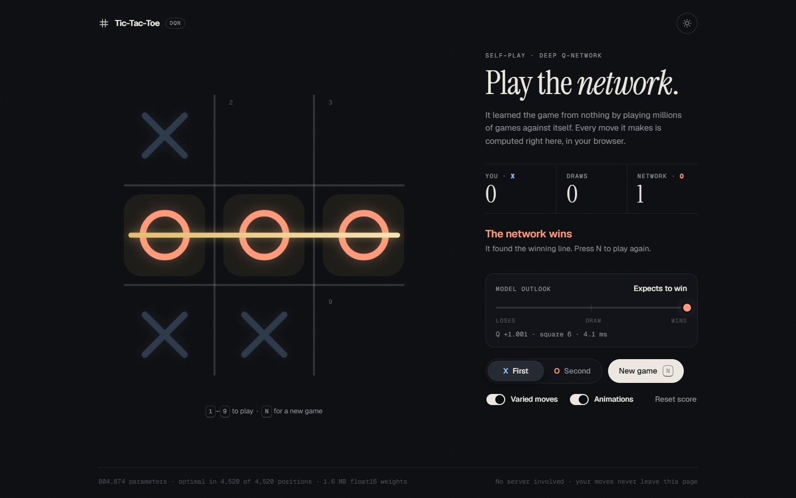
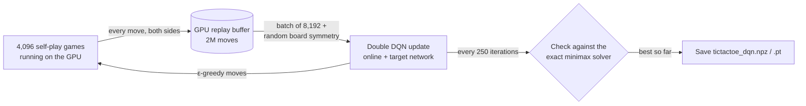

# Tic-Tac-Toe DQN

A Deep Q-Network that teaches itself Tic-Tac-Toe purely through self-play, trained on a Google Colab T4 GPU. The included model plays **perfectly**: it picks a game-theoretically optimal move in every one of the 4,520 positions that can occur in a game, so it never loses.

You can play against it in your browser, in a desktop app or inside a Colab notebook. All three run the network locally, with no server and no ML library, and reply in a few milliseconds.



## Contents

- [Results](#results)
- [Quick start](#quick-start)
- [Repository structure](#repository-structure)
- [Web player](#web-player)
- [Playing](#playing)
- [Training](#training)
- [How it works](#how-it-works)
- [Using the model in your own code](#using-the-model-in-your-own-code)
- [Troubleshooting](#troubleshooting)
- [Requirements](#requirements)

## Results

Measured on the included `tictactoe_dqn.npz` with the evaluation built into `train_dqn_colab.py` (20,000 games per match):

| Test | Result |
| --- | --- |
| Optimal moves, all reachable positions | **100.00%** (4,520 / 4,520) |
| Optimal moves, critical positions¹ | **100.00%** (3,191 / 3,191) |
| vs perfect opponent, model plays X | 100% draws, 0 losses |
| vs perfect opponent, model plays O | 100% draws, 0 losses |
| vs random opponent, model plays X | 90.95% wins, 9.05% draws, 0 losses |
| vs random opponent, model plays O | 79.97% wins, 20.02% draws, 0 losses |
| Move time, desktop app (NumPy) | about 1 ms |
| Move time, web player (JavaScript) | 1–3 ms |

¹ Positions where at least one legal move throws the result away, such as failing to block or missing a win.

Tic-Tac-Toe is a draw with best play, so against a perfect opponent every game ends drawn. Against a random opponent the win rate depends on how many mistakes that opponent makes; the figure that matters is **0 losses**.

## Quick start

### Play in your browser

Open the project's GitHub Pages site (see [Publishing on GitHub Pages](#publishing-on-github-pages)), or preview it locally:

```bash
python -m http.server -d docs
```

Then open <http://localhost:8000>. Opening `docs/index.html` directly as a file won't work, because browsers block it from loading the model.

### Play on your computer

```bash
pip install numpy
python play_dqn.py
```

The app finds `tictactoe_dqn.npz` next to the script automatically. tkinter ships with Python on Windows and macOS; on Debian or Ubuntu install it with `sudo apt install python3-tk`.

### Play in Google Colab

1. Upload `tictactoe_dqn.npz` and `play_colab.py` to a Colab session, or train a model in that session first.
2. Run the runner in a cell, either by pasting the whole file into the cell or with:

   ```python
   %run play_colab.py
   ```

If the model isn't found, the cell asks you to upload `tictactoe_dqn.npz`.

### Train your own model

1. Open [Google Colab](https://colab.research.google.com/) and choose **Runtime → Change runtime type → T4 GPU**.
2. Paste the whole of `train_dqn_colab.py` into one cell and run it, or upload the file and run `!python train_dqn_colab.py`.
3. When training finishes, `tictactoe_dqn.npz` downloads automatically if you pasted the script into a cell. With `!python`, download it from `/content/tictactoe_dqn/` in Colab's **Files** panel. Put it next to `play_dqn.py` to play against your model.

## Repository structure

```text
.
├── train_dqn_colab.py   # self-play DQN training, optimised for a Colab T4 GPU
├── play_dqn.py          # desktop app (tkinter + NumPy)
├── play_colab.py        # clickable board for Colab / Jupyter (ipywidgets + NumPy)
├── tictactoe_dqn.npz    # trained model (804,874 parameters, about 3.2 MB)
├── tools/
│   └── export_web_model.py   # converts the .npz model for the web player and verifies it
└── docs/                # the web player, published with GitHub Pages
    ├── index.html
    ├── assets/
    │   ├── app.js       # board, game flow, animations and settings
    │   ├── model.js     # loads the weights and runs the network
    │   └── style.css
    ├── model/
    │   ├── model.json   # layer shapes, checksum and evaluation summary
    │   └── weights.bin  # weights at half precision (1.6 MB)
    ├── web-screenshot.png
    └── screenshot.png   # desktop app
```

## Web player

A single static page in `docs/` that runs the network itself in JavaScript. It has no dependencies and no build step, and no server is involved after the page loads.

- **Same brain as the desktop app.** It uses the same network, the same board encoding and the same varied-move rule as `play_dqn.py`.
- **Small download.** Weights are stored at half precision: 1.6 MB instead of 3.2 MB. At half precision the model still picks an optimal move in all 4,520 positions; `tools/export_web_model.py` checks this on every export. The page also verifies the file's SHA-256 checksum before using it.
- **Fast.** A move takes 1–3 ms, and the network is warmed up right after loading so even the first move is instant.
- **Interface.**
  - Marks draw themselves like pen strokes, and the winning line is drawn in gold.
  - A preview of your mark appears when you hover over a square.
  - A *model outlook* meter shows what the network expects after each move: its Q-value, the square it chose and how long the move took.
  - Light and dark themes are included.
- **Controls.** Play as X or O, New game (or **N**), keys **1–9**, Reset score, and switches for varied moves and animations. Animations default to off when the system's "reduce motion" setting is on.
- **Remembered between visits.** Your score, side, switches and theme are saved in the browser.
- **Phones and tablets.** On screens narrower than 900 px the layout becomes one column:
  - the score with **New game** and **Reset score** at the top;
  - then the board, where a **New game** button appears once a game ends;
  - then the status, model outlook and settings.
- **Accessibility.** Squares are real buttons with descriptive labels, everything works from the keyboard, and status changes are marked for screen readers to announce.

### Publishing on GitHub Pages

1. Push the repository to GitHub.
2. Open **Settings → Pages**.
3. Under **Build and deployment**, choose **Deploy from a branch**, select your main branch and the **/docs** folder, then **Save**.
4. After a minute the game is live at `https://<your-user-name>.github.io/<repository-name>/`.

`docs/.nojekyll` tells GitHub Pages to serve the files exactly as they are.

### Updating the web model

After training a new model, export it for the web player:

```bash
python tools/export_web_model.py              # reads tictactoe_dqn.npz
python tools/export_web_model.py path/to/model.npz --float32   # optional: full precision (3.2 MB)
```

The script rewrites `docs/model/` and reports how many of the 4,520 positions the exported weights play perfectly. It warns if half precision ever costs accuracy or makes varied moves unsafe. The page adds the checksum to the weights URL, so visitors always get the new file rather than a cached old one.

## Playing

### Desktop app (`play_dqn.py`)

| Action | How |
| --- | --- |
| Place your mark | Click a square, or press **1–9** (numbered row by row from the top left) |
| New game | **New game** button, **N** or **F2**. Works at any moment, even mid-animation |
| Choose your side | **X first** (you start) or **O second** (the AI starts). Switching starts a new game |
| Reset the score | **Reset score** |
| Varied AI moves | On by default. See [Varied moves](#varied-moves) |
| Animations | On by default. Switch off for fully instant moves |
| Change model | **Model** menu. Lists every model found next to the script, plus **Open another model…** |

After every AI move the status line shows which square the AI chose, what it expects (win, draw or loss, judged from its Q-value) and how long the move took.

You can also start it with a specific model:

```bash
python play_dqn.py path/to/tictactoe_dqn.npz
```

### Colab board (`play_colab.py`)

The same game rendered with ipywidgets: pick X or O, click squares, and press **New game** to restart. The **Varied AI moves** checkbox works as it does in the desktop app. Highlighting shows the AI's last move and the winning line.

A clickable board needs the notebook itself, so run it in a cell (pasted or with `%run`), not with `!python`.

## Training

### What happens when you run it

1. **Solve the game exactly.** A minimax solver scores every reachable position. It is used only to *measure* the network, never to train it.
2. **Self-play.** 4,096 games run in parallel on the GPU, with one network playing both sides.
3. **Learn.** Every move goes into a GPU replay buffer, and the network learns from random batches of past moves with Double DQN.
4. **Evaluate and keep the best.** Every 250 iterations the network is checked against the exact solver and plays matches. The best checkpoint so far is saved.
5. **Stop.** Training ends after 40,000 iterations, or earlier once play has been perfect for 12 evaluations in a row (never before the halfway point).

A full run is 40,000 iterations × 4,096 games, about 164 million moves and about 80,000 gradient updates.

### Training log

Each evaluation prints one line, for example:

```text
[14:32:10] it   5000/40000 | upd   9904 | loss 0.00012 | acc 100.00% (100.00%) | perfect X 0/4096/0 O 0/4096/0 | random X 3712/384/0 O 3270/826/0 | self-play draws 46.0% |   180 upd/s | 0h05m12s  * saved
```

| Field | Meaning |
| --- | --- |
| `acc` | Share of all 4,520 positions where the network picks an optimal move (critical positions in brackets) |
| `perfect X` / `O` | Win/draw/loss against a perfect opponent, with the model playing X or O |
| `random X` / `O` | Win/draw/loss against a random opponent |
| `self-play draws` | Share of self-play games ending in a draw; rises as both sides improve |
| `* saved` | This checkpoint is the best so far and has been saved |

The numbers in the example line are illustrative.

### Outputs

Saved in `/content/tictactoe_dqn/`:

| File | Contents |
| --- | --- |
| `tictactoe_dqn.npz` | Best model as plain NumPy weights; this is what the players load |
| `tictactoe_dqn.pt` | Best model as a full PyTorch checkpoint, with config and metrics |
| `training_curves.png` | Accuracy and loss over training |
| `history.json` | Every evaluation, the config and the final report |

The best checkpoint is saved every time it improves, so a disconnected session still leaves the best model so far. Files in `/content` disappear when the Colab runtime resets; set `save_to_drive` to `True` to copy them to Google Drive at the end.

### Configuration

All settings live in the `CONFIG` dictionary at the top of `train_dqn_colab.py`:

| Setting | Default | Purpose |
| --- | --- | --- |
| `n_envs` | 4,096 | Games played in parallel on the GPU |
| `iterations` | 40,000 | Training length; one iteration is one move in every game |
| `buffer_size` | 2,000,000 | Replay buffer capacity, in moves |
| `warmup_transitions` | 200,000 | Moves collected before learning starts |
| `batch_size` | 8,192 | Moves per gradient update |
| `updates_per_iter` | 2 | Gradient updates per iteration |
| `hidden` / `head_hidden` | 512 / 256 | Network width |
| `gamma` | 0.9 | Discount factor; prefers faster wins and slower losses |
| `tau` | 0.005 | Target-network averaging per update |
| `lr` → `lr_min` | 1e-3 → 1e-5 | Learning rate with cosine decay |
| `eps_decay_frac` | 0.4 | Share of training over which exploration decays |
| `eps_floor_min` / `eps_floor_max` | 0.02 / 0.5 | Minimum exploration of each game, spread across the games |
| `use_amp` | `True` | FP16 mixed precision on the T4's tensor cores |
| `eval_every` | 250 | Iterations between evaluations |
| `early_stop_evals` | 12 | Perfect evaluations in a row needed to stop early |
| `save_to_drive` | `False` | Copy outputs to `MyDrive/tictactoe_dqn` at the end |
| `download_at_end` | `True` | Download `tictactoe_dqn.npz` when finished |
| `allow_cpu` | `False` | Allow training without a GPU (much slower) |

## How it works



### One network for both players

The board is always shown to the network from the point of view of the player about to move: their own marks are `+1`, the opponent's `-1`, empty squares `0`. That means a single network plays X and O alike. The input is 27 one-hot features: 9 for "my mark", 9 for "opponent's mark" and 9 for "empty".

### Learning target

Because the next position belongs to the opponent, its value is negated (a *negamax* formulation). With Double DQN the target for a move is:

$$
y =
\begin{cases}
r & \text{if the move ended the game} \\
-\gamma \, Q_{\text{target}}\big(s',\ \arg\max_{a'} Q_{\text{online}}(s', a')\big) & \text{otherwise}
\end{cases}
$$

where $r = 1$ for a win and $0$ for a draw. A move can never lose on the spot in Tic-Tac-Toe, and illegal moves are masked out, so no other rewards or penalties are needed. Q-values therefore read as **+1 = win, 0 = draw, −1 = loss**, discounted by how many moves away the result is.

### Network

A dueling Q-network with 804,874 parameters:

```text
27 inputs ─ Linear 512 ─ ReLU ─ Linear 512 ─ ReLU ─ Linear 512 ─ ReLU ─┬─ Linear 256 ─ ReLU ─ Linear 1  (value V)
                                                                        └─ Linear 256 ─ ReLU ─ Linear 9  (advantage A)
Q = V + A − mean(A)
```

### Training details

- **GPU self-play.** Boards, moves, win checks and the replay buffer all live on the GPU as tensors, so the CPU never becomes a bottleneck.
- **Symmetry augmentation.** Each sampled move is randomly rotated or mirrored (one of the 8 symmetries of the board). This multiplies the effective data by eight.
- **Exploration.** ε starts at 1 (fully random) and decays over the first 40% of training. Each of the 4,096 games also keeps its own exploration floor between 0.02 and 0.5, so rarely seen positions keep being visited.
- **Optimisation.** Huber loss, fused Adam, gradient clipping at 10, Polyak-averaged target network and FP16 mixed precision with gradient scaling.
- **Model selection.** The checkpoint with the most optimal moves is kept, with fewest lost evaluation games as the tie-breaker. Evaluation runs in full FP32, exactly like the players, so the reported accuracy is what you get when playing.

### Varied moves

A trained network always picks the same move in the same position. With **Varied AI moves** on, the AI instead picks at random among moves that are *exactly as good* as its best one:

- **Mirror and rotation copies.** On a symmetric board, such as the empty board, a move and its mirror image are the same move, so either is equally good.
- **Equal Q-values.** Moves whose Q-value is within 0.05 of the best one. Checked against the exact solver on the included model, any margin up to 0.10 never allows a weaker move and never skips an immediate win.

With this on, the model still plays an optimal move in 100% of positions but opens on all nine squares (every opening is a draw with best play), so games no longer repeat.

## Using the model in your own code

`tictactoe_dqn.npz` holds plain NumPy arrays, so the model runs anywhere NumPy does:

```python
import numpy as np
from play_dqn import DQNPlayer   # play_dqn imports tkinter at the top

ai = DQNPlayer("tictactoe_dqn.npz")

board = np.zeros(9, dtype=np.int8)   # squares 0-8, row by row: +1 = X, -1 = O, 0 = empty
board[4] = 1                          # X has taken the centre

move, q = ai.choose(board, me=-1)     # best move for O
print(move + 1, q)                    # e.g. "3 0.001": a corner, value about 0 (a draw)

ai.q_values(board, me=-1)             # Q-value of every square for O
```

Pass `rng=np.random.default_rng()` to `choose` to get [varied moves](#varied-moves).

**File format.** For each of the groups `body` (3 layers), `value` (2 layers) and `adv` (2 layers), layer `i` is stored as `<group>_<i>_w` with shape `(inputs, outputs)` and `<group>_<i>_b`. Apply ReLU after every `body` layer and between the layers of each head, then combine as `Q = V + A − mean(A)`.

## Troubleshooting

| Problem | Fix |
| --- | --- |
| `RuntimeError: No GPU found` when training | In Colab choose **Runtime → Change runtime type → T4 GPU**, then run again. To train on CPU anyway, set `allow_cpu` to `True` (much slower) |
| Colab board doesn't appear | Run `play_colab.py` inside a cell (pasted or `%run play_colab.py`), not with `!python` |
| `Cannot open a window` | There is no display, as on Colab or over SSH. Use `play_colab.py` in a notebook instead |
| `ModuleNotFoundError: No module named 'tkinter'` (Linux) | `sudo apt install python3-tk` |
| Desktop app says "No model loaded" | Put `tictactoe_dqn.npz` next to `play_dqn.py`, pass its path on the command line, or use **Model → Open another model…** |
| Training outputs lost after a disconnect | Files in `/content` are wiped when the runtime resets. Set `save_to_drive` to `True` |

## Requirements

| Part | Needs |
| --- | --- |
| Web player | Any modern browser (ES modules, `fetch`, SVG). Hosting is any static file server, such as GitHub Pages |
| Training | Google Colab with a T4 GPU; PyTorch 2.x and NumPy (preinstalled on Colab); matplotlib optional, for the training curves |
| Desktop app | Python 3 with NumPy and tkinter |
| Colab board | NumPy and ipywidgets (preinstalled on Colab) |

The desktop app has been tested with Python 3.9, NumPy 2.0 and Tk 8.6 on Windows 11. The web player has been tested in Microsoft Edge (Chromium) at desktop, laptop and phone sizes, and its JavaScript network has been checked against the Python version on every reachable position.
